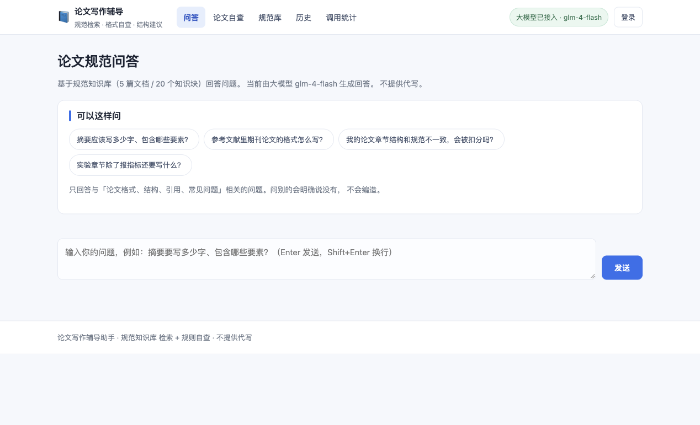
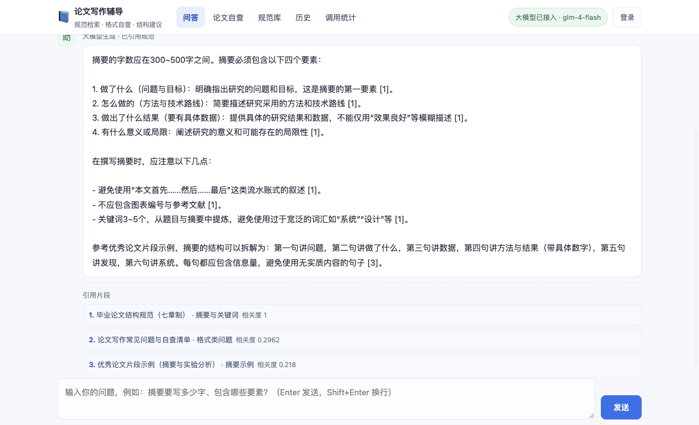
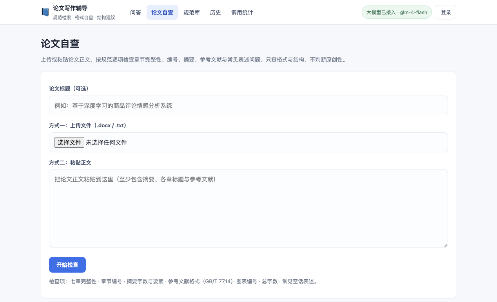
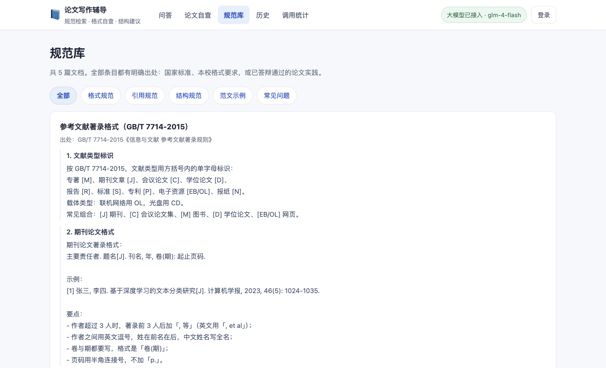
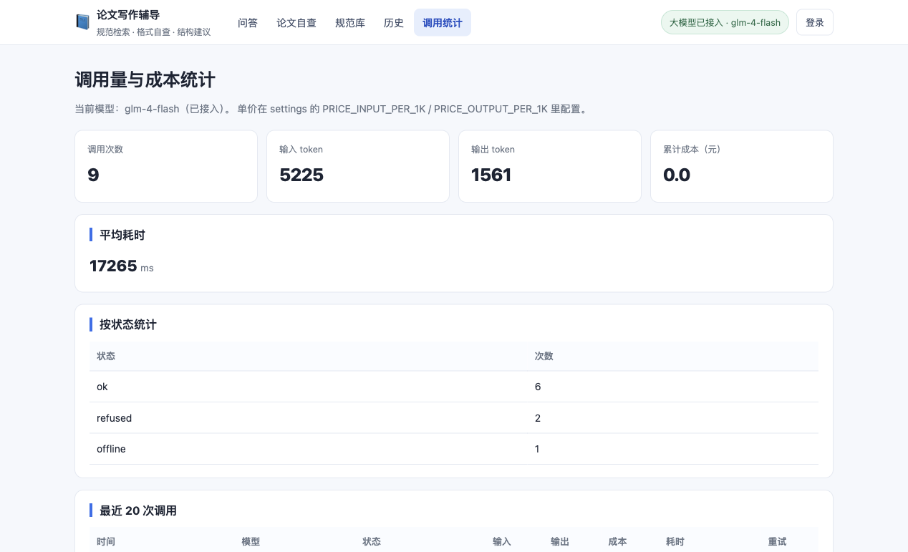

# 029 基于大模型接口的学生论文写作辅导助手-设计展示

> **代码有偿获取 可接受定制 微信联系方式: csbysj2020 或 ACE2487，备注(BS)**

> **完整源码与全套文档 · 在线自助获取 >>> [https://mbd.pub/o/bread/YZaWlplyZQ==](https://mbd.pub/o/bread/YZaWlplyZQ==)**

> **成品页（功能介绍 / 更多选题）>>> [https://bishe.suilang.net/products/thesis-advisor](https://bishe.suilang.net/products/thesis-advisor)**

> 

> 

## 视频

> **点击查看 >>> [https://www.bilibili.com/video/BV1LDWM6yEEM/](https://www.bilibili.com/video/BV1LDWM6yEEM/)**

## 项目简介

本项目面向本科毕业论文写作，做的是「随时可问的规范辅导」：把答案先钉在规范知识库上，再让大模型组织语言。问答链路是「分词 → BM25 检索 → 覆盖率门槛过滤 → 只把命中的片段喂给模型 → 回答里标注 [1][3] 序号」，下方引用卡片对应到具体是哪份规范的哪一节；检索不到就直接回「没有找到」，不调用模型、不编造答案。

第二个能力是论文自查。格式类问题（章节完整性、编号连续性、摘要字数与要素、参考文献 GB/T 7714 类型标识、图表按章编号、总字数、空话表述）本质是模式匹配，因此用确定性的规则引擎实现，共 7 类 20 余条判定，准确、可复现、零 token 成本；结果分三档：红色必须改、黄色建议改、绿色通过，每条都附具体改法。

第三个能力是写作边界控制。系统把请求分三档处理：明确要求产出整篇 / 整章成品的直接拒绝并给出四条替代路径（讲结构、给框架、查规范、改你自己的稿）；要求产出成段正文的加一句边界提示且优先给方法与结构；问方法、要检查的正常回答。判定顺序是「先放行再拒绝」，避免把「摘要怎么写」这类最该被帮助的问题误杀。

本仓库为**设计展示**：包含项目说明、技术架构、实验结果与运行截图；完整源码、任务书、开题报告、毕业论文与使用说明可通过上方链接自助获取，成品页可查看更多选题，也可联系微信咨询定制。

## 功能特性

1. 检索增强生成而非直接套大模型：先用 BM25（k1=1.5 / b=0.75）从规范知识库检索，只把命中的片段喂给模型，回答必须落在检索到的规范上

2. 每条回答附引用出处：正文里的 [1][3] 序号与下方「引用片段」卡片一一对应，标注文档标题、所属小节与相关度，答辩时能说清依据

3. 用查询词覆盖率门槛解决「无关问题被误召回」：开发实测「量子纠缠和论文有什么关系」因几乎所有块都含「论文」二字而被判命中；加入覆盖率门槛（≥34%）与泛词表后，7 个规范问题全部命中、5 个无关问题全部未命中

4. 检索不到就明说：未命中时直接回答「没有找到」，不调大模型、不编造。宁可少答，不可瞎答

5. 格式检查用确定性规则引擎而非大模型：七章完整性、章节编号连续性、摘要字数与要素、参考文献 GB/T 7714 类型标识、图表按章编号、总字数、空话表述，共 7 类 20 余条判定，准确、可复现、零 token 成本

6. 三档检查结果：红色「必须改」、黄色「建议改」、绿色「通过」，每条都附「怎么改」的具体做法，而不是只报错

7. 写作边界三档控制：明确要求整篇/整章 → 直接拒绝并给四条替代路径；要求成段正文 → 加边界提示且优先给方法与结构；问方法/要检查 → 正常回答。判定顺序是「先放行再拒绝」，避免把「摘要怎么写」误判成「要成品」

8. 大模型接口工程化：OpenAI 兼容协议（默认智谱 glm-4-flash，免费额度、国内直连无代理）、SSE 流式输出、指数退避重试（仅对超时 / 5xx / 429）、token 与成本统计

9. 无 Key 自动降级：没配 API Key 时降级为「离线检索模式」，只返回命中的规范原文并标注来源，界面状态标记同步变色，系统不崩也不编造

10. 知识库可换领域：格式通用，换成法规咨询、实验安全规范只需改 kb/data.py 与系统提示词，检索与检查逻辑一行不用改

## 技术架构

| 项目 | 说明 |
| --- | --- |
| 编程语言 | Python 3.8+ |
| Web 框架 | Django 4.2 |
| 检索方案 | BM25（k1=1.5 / b=0.75）+ jieba 分词 + 查询词覆盖率门槛 0.34 |
| 大模型 | OpenAI 兼容协议；默认智谱 glm-4-flash（免费额度、国内直连、无需代理） |
| 知识库 | 5 篇规范文档 / 20 个知识块（来源：GB/T 7714-2015、本校格式要求、已答辩论文实践） |
| 数据库 | SQLite 默认（7 张表，可切 MySQL） |
| 性能参考 | 流式首字约 1~2 秒；单次问答约 10~25 秒（取决于回答长度）；格式检查纯本地，毫秒级 |
| 网络要求 | 需要能访问大模型接口；未配 Key 时自动降级为离线检索，完全离线可用 |
| 启动方式 | 双击启动脚本，或 python3 manage.py runserver |

## 目录结构

以下为完整交付版的结构（本仓库仅作设计展示）：

```
thesis-advisor/
└── （目录树待补）
```

## 数据、测试与两处真实踩坑

| 指标 | 结果 |
| --- | --- |
| 规范知识库 | 5 篇文档 / 20 个知识块（来源：GB/T 7714-2015、本校格式要求、已答辩论文实践） |
| 检索方案 | BM25（k1=1.5 / b=0.75）+ 覆盖率门槛 0.34 + 泛词表 |
| 检索准确率 | 7 个规范问题全部命中、5 个无关问题全部未命中 |
| 核心逻辑测试 | 39 项（边界 12 / 检索 8 / 规则 10 / 端到端 4 + 结构校验），实测全部通过 |
| 大模型调用 | 默认智谱 glm-4-flash，流式首字约 1~2 秒，累计成本 0 元 |

**踩坑一：无关问题被误召回。** 最早版本把「量子纠缠和论文有什么关系」判为命中——因为知识库里几乎每个块都含「论文」二字，IDF 极低却仍有匹配。加入查询词覆盖率门槛（一个块必须命中查询实词的 ≥34%）与泛词表后才正常。调参过程与前后对比写进论文 5.1 节。

**踩坑二：用本系统检查本项目自己的论文，查出两处真实缺陷。** 一是 6 条参考文献在排版时被合并成 1 条（条目被当成普通段落合并了），二是实验对比图整张缺失（图注的 markdown 少了一个右括号）。两处都是人工审阅容易漏掉的。修复后论文再查是 0 错误 / 1 提示 / 4 通过。

## 交付内容

1. 完整源码（Django 工程、BM25 检索、大模型接口封装、写作边界判定、7 类格式规则、Web 页面）
2. 规范知识库 5 篇文档 / 20 个知识块，全部标注真实出处，可自行替换或扩写
3. 毕业论文（Word，七章制，含 BM25 与向量检索的取舍分析、覆盖率门槛的调参过程、39 项测试结果）
4. 毕业设计任务书（Word）、开题报告（Word）
5. 系统使用与二次开发说明（Word + md，14 节，含大模型 Key 配置、知识库替换、规则扩展）
6. 39 项核心逻辑测试（离线 38 项 + 在线链路 1 项，实测全部通过）
7. 自查演示样例（一份「典型问题论文」，用于现场演示三档检查结果）
8. 本系统自己的毕业论文（即用它自己生成与检查，通过自身检查器 0 错误）
9. 运行截图 6 张 + 功能演示视频（91 秒，带中文旁白）
10. 一次真实的自举验证记录：用本系统检查本项目此前论文，发现两处真实缺陷并修复

## 常见问题

**这套系统和直接问大模型有什么区别？**

三点区别，都在代码里。一是**答案有出处**：先从规范知识库检索，只把命中的片段喂给模型，回答里的 [1][3] 对应下方具体是哪份规范的哪一节。二是**不知道就说不知道**：检索不到时直接回「没有找到」，不调模型、不编造。三是**格式检查不靠模型**：章节、编号、字数、参考文献格式这些用确定性的规则引擎判定，准确、可复现、零成本。直接问大模型，这三点一个都保证不了。

**必须自己申请 API Key 吗？贵不贵？**

默认接的是智谱开放平台的 glm-4-flash，**免费额度**，注册就能用，国内直连不需要代理。实测一套完整的论文问答与自查流程，累计成本是 0 元（调用统计页有逐次记录）。不配 Key 也能跑——系统会自动降级成「离线检索模式」，只返回规范原文并标注来源。

**为什么用 BM25 不用向量检索？**

三个理由。一，规范类问题靠确定性关键词（「页边距」「卷期」「GB/T 7714」），BM25 的词面匹配比向量更准；二，交付包不用带几百 MB 的 embedding 权重，30 个知识块全量在内存里打分就够；三，向量检索的经典问题是「语义相似但无关」，「量子纠缠」能匹配上「论文」就是因为语义空间里靠得近，BM25 加覆盖率门槛没这个问题。论文 2.5 节完整论证了这一点。

**那个「覆盖率门槛」是什么？为什么要加？**

MIN_COVERAGE = 0.34：一个知识块必须命中查询里至少 34% 的实词才算命中。这条是踩坑之后加的——开发时实测「量子纠缠和论文有什么关系」，因为几乎每个知识块都含「论文」二字，被误判为命中并给出了格式建议。加了覆盖率和泛词表之后，7 个规范问题全部命中、5 个无关问题全部未命中。这个调参过程论文里有完整记录。

**会不会变成「一键出成品」的工具？**

系统对「整篇成品」请求做了三档拦截，而不是一刀切。明确要求「帮我写一整篇 / 把第三章写出来 / 给一篇能提交的成品」→ 直接拒绝，并给出四条替代路径（讲结构、给框架、查规范、改你自己的稿）；「帮我写个摘要」这类要求成段正文的 → 不拒绝，但先加一句边界提示，并且优先给方法与结构；「摘要怎么写」「检查一下格式」这类问方法的 → 正常回答。判定顺序是「先放行再拒绝」，避免把正当的写法咨询误杀。12 项边界分类测试全部通过。

**格式检查能查出什么问题？准不准？**

7 类规则 20 余条判定：七章完整性、章节编号连续性、摘要字数与要素（含「摘要里出现图表编号」）、参考文献 GB/T 7714 类型标识、图表按章编号且正文有引用、总字数、空话表述。实测能力有据：本项目的毕业论文就是用这套检查器查的，查出「6 条参考文献被合并成 1 条」（排版合并所致）和「一张实验图整张缺失」两处真实缺陷，都是人工审阅容易漏掉的。

## 截图







